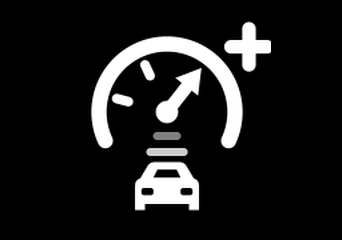

# TeslaPilot

TeslaPilot is a hobby fork of [comma.ai openpilot](https://github.com/commaai/openpilot). It should work on any car comma supports, but it's built to give you a great experience on a **stalkless Tesla Model 3 Highland**. You get Tesla-friendly controls, a Tesla-style theme, drive stats that stay on your device, and a small web page on your comma.

This is a one-person project. There's no support, and you install it at your own risk.


## What you need

- A **comma 4**. That's the only device I build and test on.
- **AGNOS 20.3.** `release` installs it on the first boot if your comma needs it. Other branches may need a different OS, so check `launch_env.sh` before you switch.
- I drive a **2026 Model 3 Highland** with the Tesla B harness. That's the car it's tested on.

The fork reports version **0.11.23** and is synced with comma openpilot **0.11.3** (`89e7e0a4c`).

## Install

On the comma's setup screen, pick **Custom Software** and enter:

```
installer.comma.ai/Memberoffoxhound/release
```

Want the newest changes before they reach `release`? Use the development branch instead. It changes often and can break:

```
installer.comma.ai/Memberoffoxhound/Highland-Dev
```

Branch names are case-sensitive. To go back to stock openpilot, enter `openpilot.comma.ai`.

## What's different from openpilot

### Engage with the scroll wheel (Tesla only)

Credit: stalkless cancel by [dkiiv](https://github.com/dkiiv) ([commaai/opendbc#3203](https://github.com/commaai/opendbc/pull/3203)), ported through [dzid26](https://github.com/dzid26)'s Tesla fork.

Stalkless Teslas don't have a cruise stalk, so press the **right scroll wheel** to engage or disengage.

### Cooperative steering (Tesla only)

Credit: [dzid26](https://github.com/dzid26)'s cooperative steering ([dzid26/sunnypilot](https://github.com/dzid26/sunnypilot), `vtb-sla`), and [AmyJeanes](https://github.com/AmyJeanes)' Tesla coop steering in sunnypilot ([sunnypilot/opendbc#287](https://github.com/sunnypilot/opendbc/pull/287)).

While engaged, you can nudge the wheel and openpilot steers with you instead of fighting you. Grab the wheel firmly and it still disengages.

### Newer Tesla firmware fix (Tesla only)

Credit: [AmyJeanes](https://github.com/AmyJeanes) ([commaai/opendbc#3389](https://github.com/commaai/opendbc/pull/3389)).

On newer Tesla firmware, the steering message is read correctly, so stock lane keeping isn't mistaken for FSD.

### Auto lane change

Credit: [rav4kumar](https://github.com/rav4kumar)'s automatic lane change in sunnypilot ([sunnypilot/sunnypilot#653](https://github.com/sunnypilot/sunnypilot/pull/653)), with [Jason Wen / sunnyhaibin](https://github.com/sunnyhaibin).

Off by default. Turn it on in **Settings → toggles → auto lane change**. Then the blinker alone starts a lane change, no wheel nudge needed, as long as you're above 25 mph and Tesla's blind-spot monitor says the lane is clear.

### Set Speed Assist



Credit: Zeph Leggett, ported from [zoompilot](https://github.com/zoompilot/zoompilot) ([sunnypilot/sunnypilot#2083](https://github.com/sunnypilot/sunnypilot/pull/2083)).

The driving model doesn't know your set speed, so it often drives slower than you asked for, or hangs back farther from the car ahead than your following distance. Set Speed Assist adds just enough gas to get you up to your set speed, or close up to your normal following distance. It only ever adds gas, never takes any away, and the model still decides when to slow down.

Off by default. Turn it on in **Settings → toggles → set speed assist**. It needs openpilot longitudinal control (**Settings → developer → alpha longitudinal**) and does nothing without it. When it's on, the icon above shows on Home. Tap it to get back to the toggle.

### Step aside for Tesla FSD (Tesla only)

On by default. If Tesla Autosteer, FSD, or Summon is selected or active, TeslaPilot gets out of the way and sends nothing to the car. It comes back when you're on TACC again.

### Tesla theme

**Settings → theme**:

- **onroad UI**: stock comma view or the custom view with a compass.
- **compass size**: small or large.
- **theme**: Tesla Autopilot blue (default) or openpilot green.


### Drive stats, kept on your device

Your drive stats stay on the comma and nothing gets uploaded. Turn them on with **Settings → toggles → go offroad in park** (there's a note below on why a Tesla needs this).

**Trip summary card.** When a drive ends, you get a card with the distance, percent engaged, day streak, best engaged stretch, and a timeline of the drive in comma connect's colors. It stays up for 20 seconds or until you tap it, then goes to Home. Swipe back to see it again any time before your next drive.


**Day and Week on Home.** Home shows today's and this week's distance and percent engaged. Tap the row to open **Statistics**, which you can also find in **Settings → statistics**.


| Engaged | Weekly | Monthly |
|:---:|:---:|:---:|
|  |  |  |

**How a drive is counted.** The comma saves the drive every 30 seconds. If it loses power, you keep everything up to the last save, and the card shows up once on the next start as "last trip summary".

**What counts as today.** Day resets at midnight and Week resets at the start of the week, both in local time where the car is. Weeks start on Sunday in the US, Canada and Japan, and on Monday in most of Europe and Australia. The comma works out its time zone from GPS with a built-in map, so it works offline. Until it gets a GPS fix, it uses its own clock's time zone. A drive counts on the day it ends, and crossing into a new time zone never moves old drives.

**Ending a drive on a Tesla (Tesla only).** A Tesla has no ignition to turn off, so openpilot would stay onroad in Park. With **go offroad in park** on, shifting into Park brings up the card and the comma goes offroad. Shift to R or D to start a new drive.

The badge at the bottom of Home shows who's handling gas and brake:

| | |
|:---:|:---|
|  | **TACC**: Tesla controls gas and brake, and openpilot steers. |
|  | **LONG**: openpilot controls gas and brake (alpha, **Settings → developer → alpha longitudinal**). |

On other cars it shows **SCC** for a Kia and **STOCK / ACC** for everything else.

### Web page on your comma

Open `http://<comma-ip>:8089` on a phone or computer connected to the **same Wi-Fi or hotspot**. You'll see drive stats, device health, and screenshots, and you can record the screen. It's always running, onroad and offroad. **There's no login**, so anyone on that network can open it.

To take a screenshot on the comma, hold your finger on the screen for 3 seconds. Screenshots go to `/data/media/0/screenshots`.

### Jetlink big model (optional)

Credit: [Zeph Leggett / zoompilot](https://github.com/zoompilot): [zoompilot/jetlink](https://github.com/zoompilot/jetlink) (MIT) and the wiring in [zoompilot/zoompilot](https://github.com/zoompilot/zoompilot). TeslaPilot's adapter and model picker follow the same layout, so future Jetlink updates are easy to bring over.

Runs openpilot's big driving model on a phone or computer plugged into the comma's USB-C port. Set it up in **Settings → models**. If you leave it off, nothing changes.

### Tesla fingerprint fallback

openpilot has to recognize your car before it can drive. TeslaPilot always tries comma's normal check first. If your car isn't recognized, the comma stays in dashcam mode and asks **Are you on a Tesla?**

- **No:** you'll see a short apology and comma's usual "car not recognized" alert. On other cars, the comma still goes on and offroad with the ignition like stock. Only the Tesla-only features (step aside and go offroad in park) stay off.
- **Yes:** pick your year and model from the list (newest first, including the 2026 Model 3 and Y), then confirm twice. Your car's firmware is saved on the comma. Restart when it offers, and stay in Park until it's back onroad. After that, your car should be recognized like any other.

Saved cars live in `/data/teslapilot/fingerprints/tesla-fw-v1.json` and survive updates. Delete an entry there and the comma forgets that car on the next restart. Nothing is uploaded. A way to share your fingerprint from the web page is planned for later.

## Safety

TeslaPilot doesn't touch driver monitoring, the excessive-actuation checks, or panda safety. [SAFETY.md](SAFETY.md) has the details and the CI checks that keep it that way.

You're still the driver. Keep your eyes on the road and be ready to take over.

**THIS IS ALPHA QUALITY SOFTWARE FOR RESEARCH PURPOSES ONLY. THIS IS NOT A PRODUCT. YOU ARE RESPONSIBLE FOR COMPLYING WITH LOCAL LAWS AND REGULATIONS. NO WARRANTY EXPRESSED OR IMPLIED.**

## Help and contributing

- Found a bug? [Open an issue](https://github.com/Memberoffoxhound/openpilot/issues) with your route ID from [comma connect](https://connect.comma.ai).
- Pull requests are welcome.
- Want the drive summary card or the park logic in your own fork? See [PORTING.md](PORTING.md).
- For general openpilot help, try the [comma Discord](https://discord.comma.ai) and the [openpilot docs](https://docs.comma.ai).

## Credits

TeslaPilot is built on the work of these people and projects. Thank you!

| Feature | Source | Link |
|---|---|---|
| Everything else | comma.ai openpilot, opendbc, panda | [commaai/openpilot](https://github.com/commaai/openpilot) |
| Scroll-wheel engage/cancel | dkiiv, via dzid26's Tesla fork | [commaai/opendbc#3203](https://github.com/commaai/opendbc/pull/3203) |
| Cooperative steering | dzid26 (`vtb` / `vtb-sla`) | [dzid26/sunnypilot](https://github.com/dzid26/sunnypilot) |
| Tesla coop steering in sunnypilot | AmyJeanes | [sunnypilot/opendbc#287](https://github.com/sunnypilot/opendbc/pull/287) |
| Newer-firmware steering fix | AmyJeanes | [commaai/opendbc#3389](https://github.com/commaai/opendbc/pull/3389) |
| Auto lane change | rav4kumar, with Jason Wen (sunnyhaibin), sunnypilot | [sunnypilot/sunnypilot#653](https://github.com/sunnypilot/sunnypilot/pull/653) |
| Set Speed Assist | Zeph Leggett / zoompilot | [zoompilot/zoompilot](https://github.com/zoompilot/zoompilot), [sunnypilot/sunnypilot#2083](https://github.com/sunnypilot/sunnypilot/pull/2083) |
| Jetlink big model | Zeph Leggett / zoompilot (MIT) | [zoompilot/jetlink](https://github.com/zoompilot/jetlink), [zoompilot/zoompilot](https://github.com/zoompilot/zoompilot) |
| Model picker | zoompilot's wiring of sunnypilot's model manager | [zoompilot/zoompilot](https://github.com/zoompilot/zoompilot) |
| TESLA font (wordmark) | KAYOver, based on TeslaNikolaCaps by Shane Milburn | [dafont](https://www.dafont.com/tesla.font) |
| Inter font | Rasmus Andersson | [rsms/inter](https://github.com/rsms/inter) |
| Time zone table (`tzgrid.bin`) | timezone-boundary-builder by Evan Siroky, from OpenStreetMap data | [evansiroky/timezone-boundary-builder](https://github.com/evansiroky/timezone-boundary-builder) |
| First day of the week (`weekstart.json`) | Unicode CLDR | [cldr.unicode.org](https://cldr.unicode.org/) |

## License

openpilot and TeslaPilot are released under the [MIT license](LICENSE). Some parts use other licenses:

- **Jetlink** ([zoompilot/jetlink](https://github.com/zoompilot/jetlink)): MIT, Copyright (c) 2026 Zeph Leggett. See `jetlink_repo/LICENSE`.
- **TESLA font**: [CC BY-NC-SA 3.0](https://creativecommons.org/licenses/by-nc-sa/3.0/), non-commercial use only. See `openpilot/selfdrive/assets/fonts/TESLA-LICENSE.txt`.
- **Inter font**: [SIL Open Font License 1.1](https://openfontlicense.org).
- **Time zone table** (`openpilot/selfdrive/ui/tripstats/tzgrid.bin`): built from [timezone-boundary-builder](https://github.com/evansiroky/timezone-boundary-builder) data, © OpenStreetMap contributors, under the [Open Database License (ODbL) 1.0](https://opendatacommons.org/licenses/odbl/1-0/).
- **First day of the week** (`openpilot/selfdrive/ui/tripstats/weekstart.json`): from Unicode CLDR data, © Unicode, Inc., under the [Unicode License v3](https://www.unicode.org/license.txt).

Tesla, Kia, comma.ai, and other names and logos are trademarks of their owners, used only for identification. TeslaPilot isn't affiliated with or endorsed by any of them, and its wordmark isn't Tesla's official logo.
