# TeslaPilot

TeslaPilot is a hobby fork of [comma.ai openpilot](https://github.com/commaai/openpilot). It should work on any car comma supports, but it's built to give you a great experience on Tesla. You get Tesla-friendly controls, a Tesla-style theme, drive stats that stay on your device, and a small web page hosted on your comma.

This is a one-person project. There's no support, and you install it at your own risk.


## What you need

- A **comma 4**. That's the only device I build and test on.
- **AGNOS 20.6.** `release` installs it on the first boot if your comma needs it. Other branches may need a different OS, so check `launch_env.sh` before you switch.
- I drive a **2026 Model 3 Highland** with the Tesla B harness. That's the car it's tested on.

The fork reports version **0.11.24** and is synced with comma openpilot **0.11.4** (`4bd73298e`). On the comma 4, TeslaPilot's own labels are lowercase, matching comma 0.11.4, with acronyms like MADS and TACC left as they are. The old toggles page is now **Settings → driving**.

| Settings | Driving |
|:---:|:---:|
| 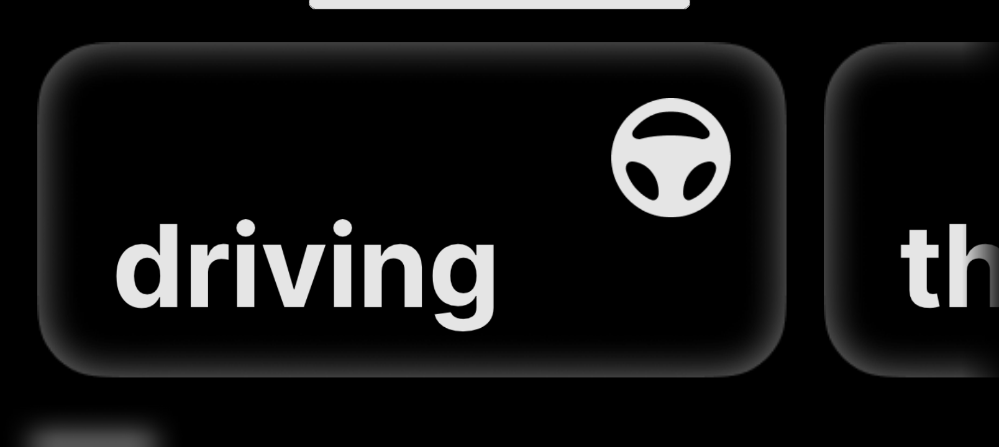 | 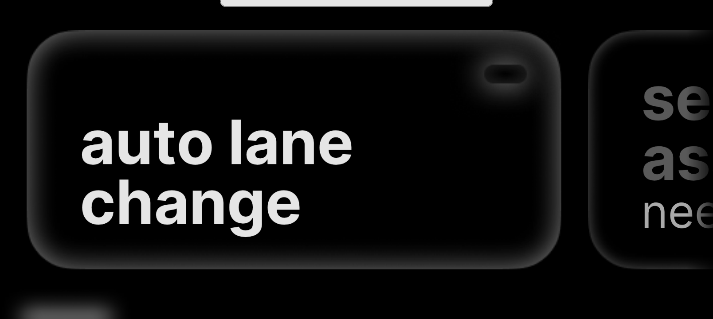 |

## Install

On the comma's setup screen, pick **Custom Software** and enter:

```
installer.comma.ai/Memberoffoxhound/release
```

Want the newest changes before they reach `release`? Use the development branch instead. It changes often and can break:

```
installer.comma.ai/Memberoffoxhound/Highland-Dev
```

Branch names are case-sensitive. To go back to stock openpilot, enter `openpilot.comma.ai`.

## What's different from openpilot

### Disengage with the scroll wheel (Tesla only)

Credit: stalkless cancel by [dkiiv](https://github.com/dkiiv) ([commaai/opendbc#3203](https://github.com/commaai/opendbc/pull/3203)), ported through [dzid26](https://github.com/dzid26)'s Tesla fork.

Stalkless Teslas don't have a cruise stalk. Press the **right scroll wheel** to disengage. Engage the usual way with TACC.

### Cooperative steering (Tesla only)

Credit: [dzid26](https://github.com/dzid26)'s cooperative steering ([dzid26/sunnypilot](https://github.com/dzid26/sunnypilot), `vtb-sla`), and [AmyJeanes](https://github.com/AmyJeanes)' Tesla coop steering in sunnypilot ([sunnypilot/opendbc#287](https://github.com/sunnypilot/opendbc/pull/287)).

While engaged, you can nudge the wheel and openpilot steers with you instead of fighting you. Grab the wheel firmly and it still disengages.

### Newer Tesla firmware fix (Tesla only)

Credit: [AmyJeanes](https://github.com/AmyJeanes) ([commaai/opendbc#3389](https://github.com/commaai/opendbc/pull/3389)).

On newer Tesla firmware, the steering message is read correctly, so stock lane keeping isn't mistaken for FSD.

### Auto lane change

Credit: [rav4kumar](https://github.com/rav4kumar)'s automatic lane change in sunnypilot ([sunnypilot/sunnypilot#653](https://github.com/sunnypilot/sunnypilot/pull/653)), with [Jason Wen / sunnyhaibin](https://github.com/sunnyhaibin).

Off by default. Turn it on in **Settings → driving → auto lane change**. Then the blinker alone starts a lane change, no wheel nudge needed, as long as you're above 45 mph and Tesla's blind-spot monitor says the lane is clear.

### Set Speed Assist

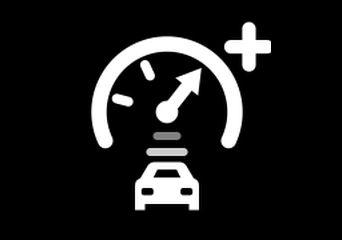

Credit: Zeph Leggett, ported from [zoompilot](https://github.com/zoompilot/zoompilot) ([sunnypilot/sunnypilot#2083](https://github.com/sunnypilot/sunnypilot/pull/2083)).

The driving model doesn't know your set speed, so it often drives slower than you asked for, or hangs back farther from the car ahead than your following distance. Set Speed Assist adds just enough gas to get you up to your set speed, or close up to your normal following distance. It only ever adds gas, never takes any away, and the model still decides when to slow down.

Off by default. Turn it on in **Settings → driving → set speed assist**. It needs openpilot longitudinal control (**Settings → developer → alpha longitudinal**) and does nothing without it. When it's on, the icon above shows on Home. Tap it to get back to the toggle.

### MADS

**MADS - Modular Assistive Driving System.**

Credit: ported from [sunnypilot](https://github.com/sunnypilot/sunnypilot)'s MADS, see [Credits](#credits).

Off by default. Turn it on in **Settings → driving → MADS**. With MADS on, TeslaPilot keeps steering when you cancel cruise while you handle speed. Engage cruise again to get speed control back. On a Tesla, pressing the brake still turns both off. Only the MADS options that work on your car show under the toggle.

The Home badge and onroad wheel. Colors are for the default Tesla theme; with the openpilot theme, blue is green.

| | |
|:---:|:---|
|  | **MADS**: shows on Home while MADS is on. Tap to open the toggle. |
|  | **Blue**: openpilot is engaged. |
| 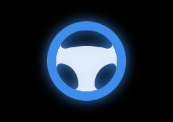 | **Blue rim**: MADS is steering. You handle speed. |
| 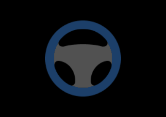 | **Dim rim**: MADS is on but not steering, like in Park or Reverse. |
|  | **White**: you're overriding, like with the gas pedal. |
|  | **Gray**: nothing is steering. |

### Big model on a chestnut or Jetlink (optional)

Credit: [Zeph Leggett / zoompilot](https://github.com/zoompilot): [zoompilot/jetlink](https://github.com/zoompilot/jetlink) (MIT) and the model manager in [zoompilot/zoompilot](https://github.com/zoompilot/zoompilot), which builds on [sunnypilot](https://github.com/sunnypilot/sunnypilot)'s. TeslaPilot uses the same layout, so future updates are easy to bring over.

Runs a big driving model on a comma chestnut, or with Jetlink on a phone or computer plugged into the comma's USB-C port. The small model that ships with TeslaPilot still drives when neither is there, and while a big model gets ready.

**Chestnut.** The comma finds a chestnut on its own when it's plugged in, and remembers it, since some chestnuts only get power while you drive. If Jetlink is off and no chestnut is present when the comma starts, that memory is cleared. It runs sunnypilot's prebuilt chestnut models. Nothing compiles on the comma: it downloads the model you pick (about 770 MB) while parked on Wi-Fi. With no pick it downloads the default, Light Speed 2. Downloads go to `/data/media/0/models`.

**Jetlink.** Jetlink is off until you turn it on in **Settings → models**: **USB** for a Mac, Jetson, Linux PC or Android, **iOS** for an iPhone or iPad. The switch is hidden while a chestnut is plugged in, since the chestnut runs the big model itself. The list of models comes from Jetlink, and the phone or computer downloads and builds the one you pick. Turning on ADB (**Settings → developer**) turns Jetlink off.

Pick a model in **Settings → models**. The list is grouped by folder, and **refresh models** fetches it again. **Clear cache** deletes every downloaded model except the one you picked. A download shows its progress and speed there, and you can cancel it.

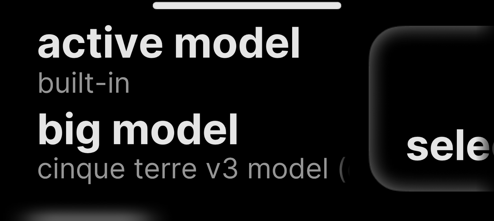

The chestnut icon on Home and onroad shows progress. It dims and fills white while a model downloads. It only turns orange if something failed. Tap it on Home to open **Settings → models**.

### Step aside for Tesla FSD (Tesla only)

On by default. If Tesla Autosteer, FSD, or Summon is selected or active, TeslaPilot gets out of the way and sends nothing to the car. It comes back when you're on TACC again.

### Tesla theme

**Settings → theme**:

- **onroad UI**: stock comma view or the custom view with a compass.
- **compass size**: small or large.
- **theme**: Tesla Autopilot blue (default) or openpilot green.

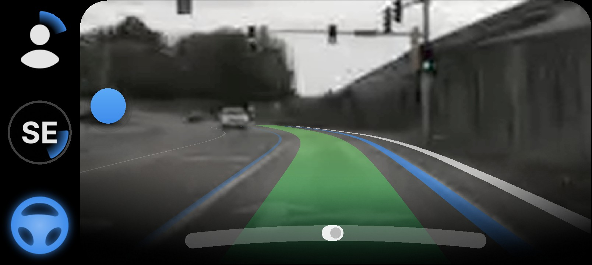

### Navigation, turn desires, and steering dropouts

Credit: [cristianku](https://github.com/cristianku)'s [Nav2Pilot](https://github.com/cristianku/nav2pilot) app ([iOS](https://github.com/cristianku/nav2pilot-ios)) and [nav-alpha](https://github.com/cristianku/openpilot/tree/nav-alpha) overlay, and turn desires from [FrogAi](https://github.com/FrogAi)'s [FrogPilot](https://github.com/FrogAi/FrogPilot), as carried in [StarPilotHQ/StarPilot](https://github.com/StarPilotHQ/StarPilot). Ported by [Memberoffoxhound](https://github.com/Memberoffoxhound).

Send a destination with stops from the Nav2Pilot app. On the comma, turn on **Settings → developer → navigation (alpha)**. Sign in to the app with a token from [jwt.comma.ai](https://jwt.comma.ai), using the account your comma is paired to. If you don't have comma prime, enter a public Mapbox token in the app (it starts with `pk.`). The app stores it in the `MapboxToken` param, which is never logged and is never kept in git. Without prime, the route still works, but the map tiles may stay black. Going offroad (shifting into Park on a Tesla) clears the destination, so send it again before the next drive. This is on-screen guidance only; it doesn't steer the car through turns.

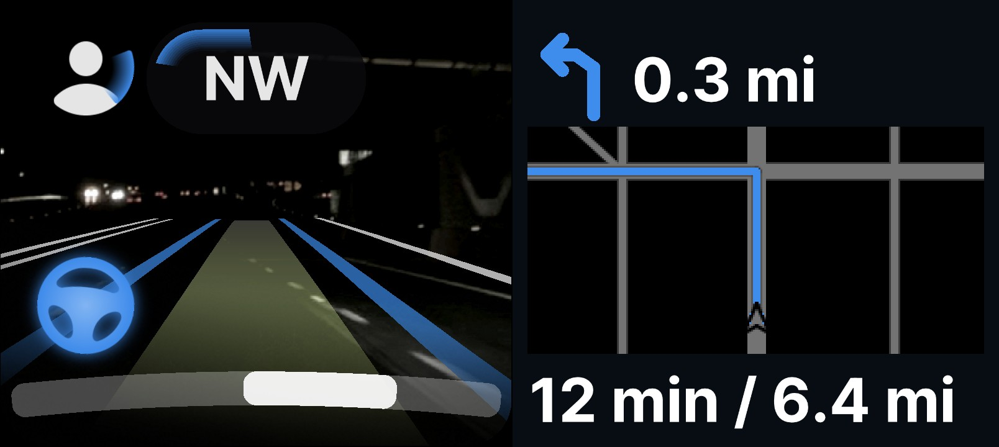

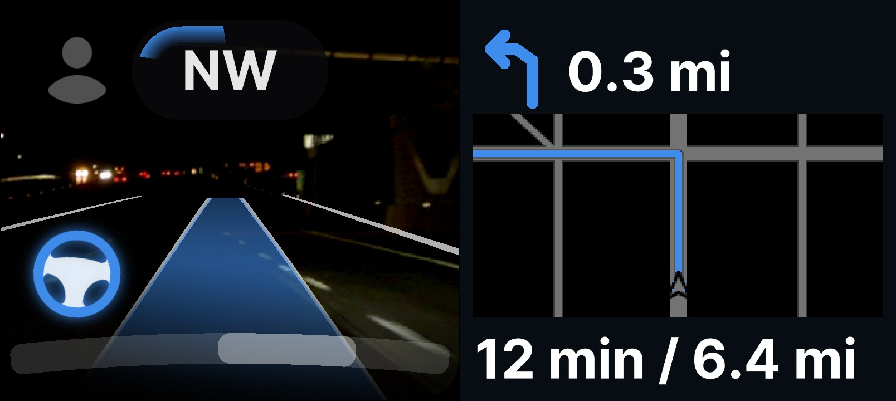

**Turn desires** is off by default. Turn it on in **Settings → driving → turn desires**. Signal anytime below 45 mph as you approach a turn. Once you slow under 20 mph, the model takes the turn. At a red light it holds until you stop or cancel the blinker. It doesn't check the blind spot (similar to StarPilot). At 45 mph and up, the blinker still means a lane change.

If the Tesla steering-column 0x129 message drops out for 1.2 seconds or less, openpilot keeps steering to the plan. Longer dropouts disengage like before, and panda safety is unchanged. A new "filtered" column in the drive summary counts dropouts that recovered.

### Drive stats, kept on your device

Your drive stats stay on the comma and nothing gets uploaded. On a Tesla, **go offroad in park** is on by default if you haven't set it; you can change it in **Settings → driving**. On other cars it stays off until you turn it on. There's a note below on why a Tesla needs this.

**Trip summary card.** When a drive ends, you get a card with the distance, percent engaged, streak, day streak, how many steering-sensor dropouts were filtered, and a timeline of the drive in comma connect's colors. It stays up for 20 seconds or until you tap it, then goes to Home. Swipe back to see it again any time before your next drive.

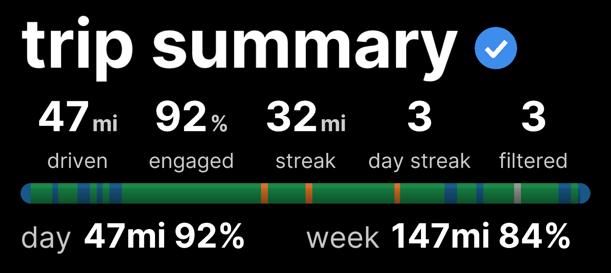

**Day and Week on Home.** Home shows today's and this week's distance and percent engaged. Tap the row to open **Statistics**, which you can also find in **Settings → statistics**.

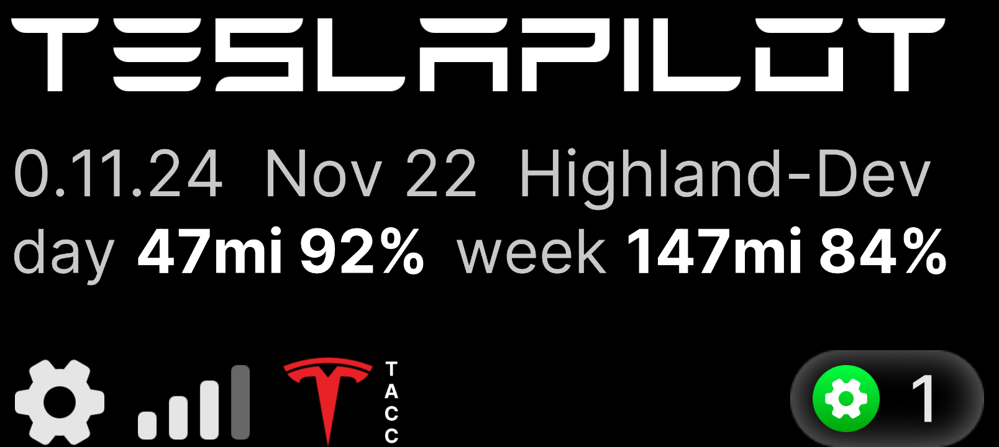

| Engaged | Weekly | Monthly |
|:---:|:---:|:---:|
| 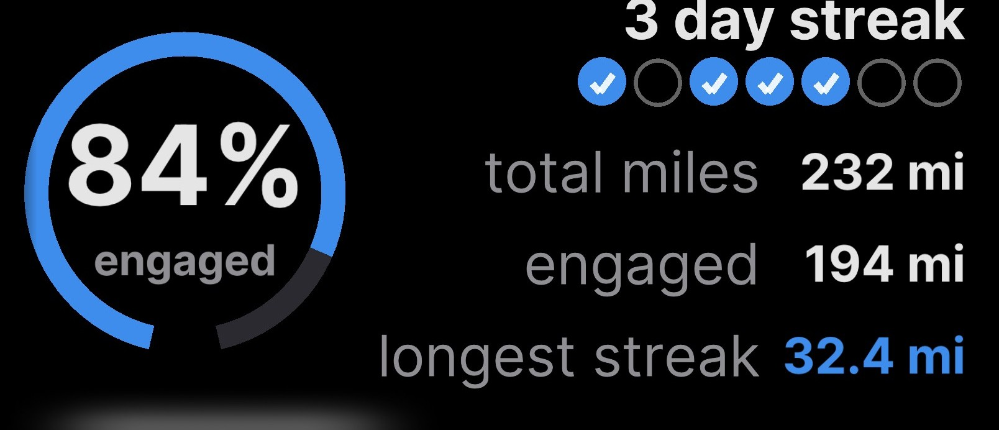 | 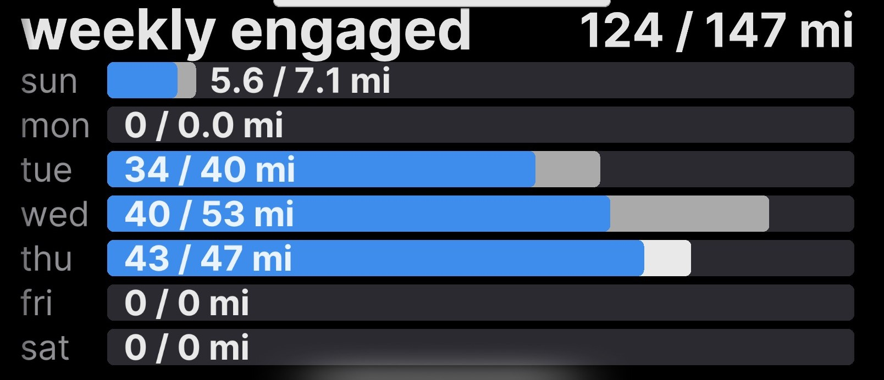 | 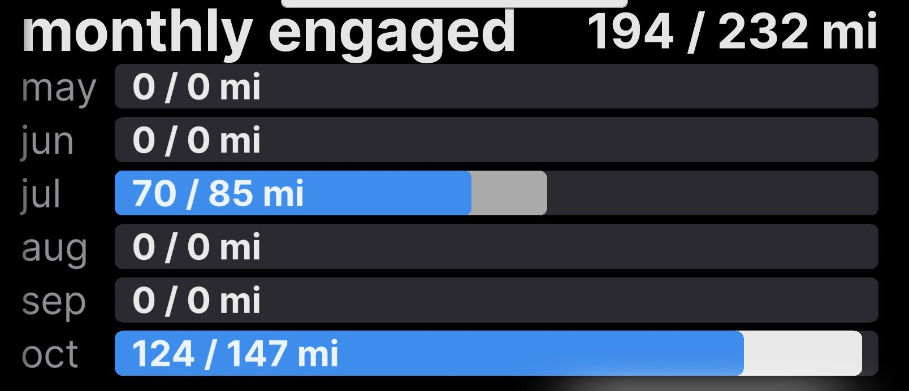 |

**How a drive is counted.** The comma saves the drive every 30 seconds. If it loses power, you keep everything up to the last save, and the card shows up once on the next start as "last trip summary".

**What counts as today.** Day resets at midnight and Week resets at the start of the week, both in local time where the car is. Weeks start on Sunday in the US, Canada and Japan, and on Monday in most of Europe and Australia. The comma works out its time zone from GPS with a built-in map, so it works offline. Until it gets a GPS fix, it uses its own clock's time zone. A drive counts on the day it ends, and crossing into a new time zone never moves old drives.

**Ending a drive on a Tesla (Tesla only).** A Tesla has no ignition to turn off, so openpilot would stay onroad in Park. With **go offroad in park** on, shifting into Park brings up the card and the comma goes offroad. Shift to R or D to start a new drive.

The badge at the bottom of Home shows who handles gas and brake:

| | |
|:---:|:---|
|  | **TACC**: Tesla handles gas and brake. openpilot steers. |
| 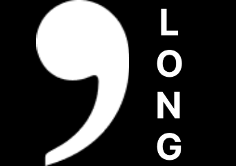 | **LONG**: openpilot handles gas and brake (alpha, **Settings → developer → alpha longitudinal**). |
|  | **MADS**: shows next to LONG or TACC when MADS is on. |

On other cars it shows **SCC** for a Kia and **STOCK / ACC** for everything else.

### Web page on your comma

Open `http://<comma-ip>:8089` on a phone or computer connected to the **same Wi-Fi or hotspot**. You'll see drive stats, device health, and screenshots. It's always running, onroad and offroad. **There's no login**, so anyone on that network can open it.

To take a screenshot on the comma, hold your finger on the screen for 3 seconds. Screenshots go to `/data/media/0/screenshots`.

### Tesla fingerprint fallback

openpilot has to recognize your car before it can drive. TeslaPilot always tries comma's normal check first. If your car isn't recognized, the comma stays in dashcam mode and asks **Are you on a Tesla?**

- **No:** you'll see a short apology and comma's usual "car not recognized" alert. On other cars, the comma still goes on and offroad with the ignition like stock. Only the Tesla-only features (step aside and go offroad in park) stay off.
- **Yes:** pick your year and model from the list (newest first, including the 2026 Model 3 and Y), then confirm twice. Your car's firmware is saved on the comma. Restart when it offers, and stay in Park until it's back onroad. After that, your car should be recognized like any other.

Saved cars live in `/data/teslapilot/fingerprints/tesla-fw-v1.json` and survive updates. Delete an entry there and the comma forgets that car on the next restart. Nothing is uploaded. A way to share your fingerprint from the web page is planned for later.

## Safety

TeslaPilot doesn't touch driver monitoring, the excessive-actuation checks, or panda safety. [SAFETY.md](SAFETY.md) has the details and the CI checks that keep it that way.

You're still the driver. Keep your eyes on the road and be ready to take over.

**THIS IS ALPHA QUALITY SOFTWARE FOR RESEARCH PURPOSES ONLY. THIS IS NOT A PRODUCT. YOU ARE RESPONSIBLE FOR COMPLYING WITH LOCAL LAWS AND REGULATIONS. NO WARRANTY EXPRESSED OR IMPLIED.**

## Help and contributing

- Found a bug? [Open an issue](https://github.com/Memberoffoxhound/openpilot/issues) with your route ID from [comma connect](https://connect.comma.ai).
- Pull requests are welcome.
- Want the drive summary card or the park logic in your own fork? See [PORTING.md](PORTING.md).
- For general openpilot help, try the [comma Discord](https://discord.comma.ai) and the [openpilot docs](https://docs.comma.ai).

## Credits

TeslaPilot is built on the work of these people and projects. Thank you!

| Feature | Source | Link |
|---|---|---|
| Scroll-wheel cancel | dkiiv, via dzid26's Tesla fork | [commaai/opendbc#3203](https://github.com/commaai/opendbc/pull/3203) |
| Cooperative steering | dzid26 (`vtb` / `vtb-sla`) | [dzid26/sunnypilot](https://github.com/dzid26/sunnypilot) |
| Tesla coop steering in sunnypilot | AmyJeanes | [sunnypilot/opendbc#287](https://github.com/sunnypilot/opendbc/pull/287) |
| Newer-firmware steering fix | AmyJeanes | [commaai/opendbc#3389](https://github.com/commaai/opendbc/pull/3389) |
| Auto lane change | rav4kumar, with Jason Wen (sunnyhaibin), sunnypilot | [sunnypilot/sunnypilot#653](https://github.com/sunnypilot/sunnypilot/pull/653) |
| Set Speed Assist | Zeph Leggett / zoompilot (MIT) | [zoompilot/zoompilot](https://github.com/zoompilot/zoompilot), [sunnypilot/sunnypilot#2083](https://github.com/sunnypilot/sunnypilot/pull/2083) |
| Jetlink big model | Zeph Leggett / zoompilot (MIT) | [zoompilot/jetlink](https://github.com/zoompilot/jetlink), [zoompilot/zoompilot](https://github.com/zoompilot/zoompilot) |
| Model manager, chestnut models, `SPTGPLN1` loader, models UI | zoompilot's wiring of sunnypilot's model manager and plain tinygrad loader | [zoompilot/zoompilot](https://github.com/zoompilot/zoompilot), [sunnypilot/sunnypilot](https://github.com/sunnypilot/sunnypilot) |
| MADS | sunnypilot | [sunnypilot/sunnypilot](https://github.com/sunnypilot/sunnypilot), [sunnypilot/opendbc](https://github.com/sunnypilot/opendbc), [sunnypilot/panda](https://github.com/sunnypilot/panda) |
| Nav2Pilot and nav-alpha overlay | cristianku, ported by Memberoffoxhound | [cristianku/nav2pilot](https://github.com/cristianku/nav2pilot), [nav-alpha](https://github.com/cristianku/openpilot/tree/nav-alpha) |
| Turn desires | FrogAi / FrogPilot, as carried in StarPilotHQ/StarPilot, ported by Memberoffoxhound | [FrogAi/FrogPilot](https://github.com/FrogAi/FrogPilot), [StarPilotHQ/StarPilot](https://github.com/StarPilotHQ/StarPilot) |
| Step aside, fingerprint fallback, Tesla theme, drive stats, web page, 0x129 grace window | Memberoffoxhound | [TeslaPilot](https://github.com/Memberoffoxhound/TeslaPilot) |
| TESLA font (wordmark) | KAYOver, based on TeslaNikolaCaps by Shane Milburn | [dafont](https://www.dafont.com/tesla.font) |
| Inter font | Rasmus Andersson | [rsms/inter](https://github.com/rsms/inter) |
| Time zone table (`tzgrid.bin`) | timezone-boundary-builder by Evan Siroky, from OpenStreetMap data | [evansiroky/timezone-boundary-builder](https://github.com/evansiroky/timezone-boundary-builder) |
| First day of the week (`weekstart.json`) | Unicode CLDR | [cldr.unicode.org](https://cldr.unicode.org/) |
| Everything else | comma.ai openpilot, opendbc, panda | [commaai/openpilot](https://github.com/commaai/openpilot) |

MADS, model manager, `SPTGPLN1` loader, and models UI: This project uses software from Haibin Wen and SUNNYPILOT LLC and is licensed under a custom license requiring permission for use.

## License

openpilot and TeslaPilot are released under the [MIT license](LICENSE). Some parts use other licenses:

- **Jetlink** ([zoompilot/jetlink](https://github.com/zoompilot/jetlink)): MIT, Copyright (c) 2026 Zeph Leggett. See `jetlink_repo/LICENSE`.
- **TESLA font**: [CC BY-NC-SA 3.0](https://creativecommons.org/licenses/by-nc-sa/3.0/), non-commercial use only. See `openpilot/selfdrive/assets/fonts/TESLA-LICENSE.txt`.
- **Inter font**: [SIL Open Font License 1.1](https://openfontlicense.org).
- **zoompilot** ports (Set Speed Assist, big-model wiring, Jetlink adapter): MIT, Copyright (c) 2026 Zeph Leggett. See [LICENSE.zoompilot](LICENSE.zoompilot).
- **sunnypilot** ports (MADS, model manager, `SPTGPLN1` loader, models UI): sunnypilot's custom license, kept in each repo with ported code as `LICENSE.sunnypilot`.
- **Time zone table** (`openpilot/selfdrive/ui/tripstats/tzgrid.bin`): built from [timezone-boundary-builder](https://github.com/evansiroky/timezone-boundary-builder) data, © OpenStreetMap contributors, under the [Open Database License (ODbL) 1.0](https://opendatacommons.org/licenses/odbl/1-0/).
- **First day of the week** (`openpilot/selfdrive/ui/tripstats/weekstart.json`): from Unicode CLDR data, © Unicode, Inc., under the [Unicode License v3](https://www.unicode.org/license.txt).

Tesla, Kia, comma.ai, and other names and logos are trademarks of their owners, used only for identification. TeslaPilot isn't affiliated with or endorsed by any of them, and its wordmark isn't Tesla's official logo.
